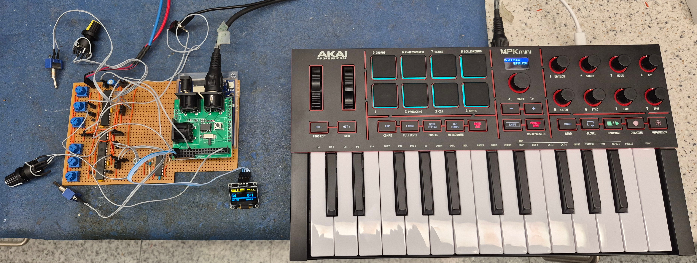

# RetroDASynth

**RetroDASynth** is an open-source project to build a modular, polyphonic, retro-style electronic music synthesiser from inexpensive, readily available components. Its central idea is to use **the same general-purpose circuit board for different synthesiser modules**: load different software onto its microcontroller, and the board can become a voltage-controlled oscillator (VCO), a voltage-controlled filter (VCF), an envelope generator, or potentially another audio or control function. Modules can then be connected to make different instruments and signal-processing arrangements.

The design aims to be accessible to hobbyists: through-hole components where practicable, hand-solderable PCBs, 3D-printable mechanical parts, straightforward 5 V power, and published hardware and software. The ultimate aim is a self-contained, MIDI-controlled, polyphonic instrument, with sequencing and facilities for experimenting with the signal chain.

It is being created by Adrian Bowyer with significant inputs from ChatGPT.

## The prototype so far

The photograph above shows the current experimental system. **A working monophonic MIDI-controlled voice** has been demonstrated, using:

- An **Arduino UNO R4 WiFi** as the MIDI receiver and controller. It reads MIDI note messages, generates a pitch-control voltage and drives an active-low gate output.
- An **AVR32DA28** programmed as a VCO, producing audio using its internal DAC.
- A second **AVR32DA28** programmed as an envelope generator; its control voltage adjusts the VCO's output level.
- An **MCP6004** quad operational amplifier for analogue buffering and related signal conditioning.
- A **128 × 64 I²C OLED** on the Arduino, showing MIDI status, the last note, velocity and current monophonic voice activity.

The complete assembled prototype runs from a **single regulated 5 V supply**. In one test it drew approximately **109 mA** at 5 V (about 0.55 W), and played in tune. That measurement is for the present prototype, not a forecast for the finished polyphonic instrument.

## One board, several functions

The common module design is based on the **Microchip AVR32DA28**, a 28-pin, through-hole microcontroller with analogue-to-digital conversion, a digital-to-analogue converter, timers and digital I/O. The idea is to standardise the connections to controls, patch sockets and power, while changing the firmware to determine each module's behaviour.

The following functions have been developed and tested experimentally:

### Voltage-controlled oscillator (VCO)

- Produces **sine**, **triangle/sawtooth**, **square/pulse**, and **noise** waveforms.
- Waveform selection, pitch, shape and amplitude are voltage- or switch-controlled.
- Uses the AVR's **10-bit DAC**, driven by a timer-based waveform generator.
- Provides a low-frequency mode, allowing the same oscillator design to generate slowly varying control signals.
- Uses a pitch relationship of approximately **0.75 V per octave** in the present software; this is a project-specific convention, **not** the more usual 1 V/octave analogue-synthesiser standard.
- The analogue circuit provides buffered and inverted outputs. A filtered PWM signal establishes the reference needed for the complementary output.

### Voltage-controlled filter (VCF)

- A software-defined, two-pole **state-variable filter**, developed and tested on the AVR32DA28.
- Switch-selectable **low-pass, high-pass, band-pass and notch** responses.
- Voltage-controlled cutoff and resonance, with an option to experiment with self-oscillation.
- Processes an analogue audio input through the microcontroller's ADC and DAC.

This filter has been tested as a separate module; it is **not yet part of the MIDI-controlled voice shown in the prototype photograph**. Input bias handling and gain/headroom are subjects for further development.

### Envelope generator

- Produces a control voltage in response to a gate signal.
- Adjustable attack, decay and level, with several selectable envelope shapes.
- Supports experiments with gated and one-shot behaviour.
- In the present prototype, the envelope controls the VCO's output amplitude.

## MIDI controller and display

The Arduino UNO R4 WiFi currently receives **DIN MIDI** via a MIDI shield and operates in a simple **monophonic** mode. Its DAC output on **A0** supplies pitch CV; digital pin **D2** supplies the active-low envelope gate. The small OLED is connected over I²C.

The current display shows the last MIDI note, its velocity, whether the single voice is active, and basic MIDI status. Features such as channel selection, polyphonic voice allocation, sustain-pedal handling and sequencing are **planned, not yet implemented**.

The prototype currently uses the R4's built-in DAC for pitch. For the polyphonic design, the intention is to use **a separate dual-channel, 12-bit SPI DAC for each voice** (a possible device is the through-hole **MCP4822**), providing independent **pitch and velocity/control voltages**. This is a design proposal, not an installed part of the photographed prototype.

## Intended polyphonic architecture

The proposed arrangement is:

1. The central Arduino receives MIDI and, eventually, runs a sequencer and allocates notes to available voices.
2. Each voice has its own pitch and amplitude-control voltages, plus an envelope gate.
3. Each voice is assembled from common programmable modules, initially an oscillator and envelope generator, with filters added as desired.
4. The audio outputs are mixed to produce the instrument's final sound.

A first polyphonic build will probably have a modest number of voices, with the design able to expand. Voice stealing, MIDI sustain and channel-specific controls will be addressed as the instrument develops.

## Hardware and software

The repository is organised into:

- [`Electronics/`](Electronics/) — electronic design material.
- [`Software/`](Software/) — firmware and related software.
- [`Docs/`](Docs/) — documentation.
- [`Pix/`](Pix/) — photographs and illustrations, including the prototype picture above.

Firmware development uses the **Arduino IDE** and **DxCore** for the AVR DA-series microcontrollers. The MIDI controller uses the Arduino UNO R4 WiFi environment. The electronic design work uses **KiCad**.

**Project status:** experimental development. The circuits and programs are evolving, and a tested breadboard prototype should not be mistaken for a final, documented, ready-to-build kit.

## Next steps

- Develop and manufacture the standard through-hole module PCB.
- Extend the controller from one note to multiple independently allocated voices.
- Move pitch and velocity/control outputs to external, per-voice SPI DACs.
- Add MIDI channel selection, diagnostics and sustain-pedal support.
- Integrate the filter into complete voices, and develop audio mixing.
- Add sequencing, and develop the interlocking 3D-printed module/panel system.

## Licence

This repository includes the [GNU General Public License, version 3](LICENSE). See that file for the applicable licence terms.

## Written by

Adrian Bowyer and ChatGPT
